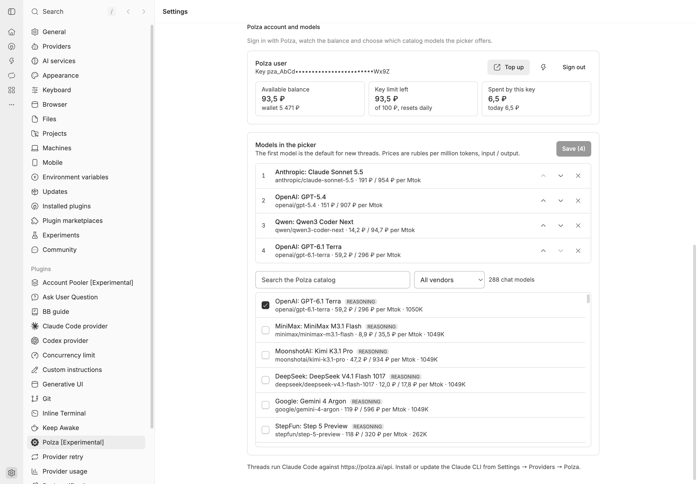
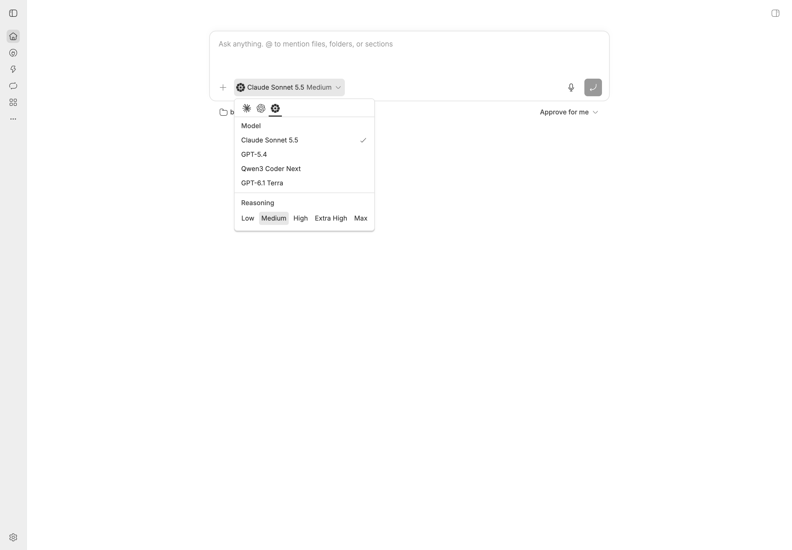

# bb-plugin-polza

A [bb](https://getbb.app) plugin that adds the **Polza** agent provider: run bb threads on [polza.ai](https://polza.ai) models with Claude Code as the engine, sign in with your Polza account, choose the models the picker offers, and see your balance and ruble spend in bb.

## Install

```sh
bb plugin install https://github.com/polza-ai/bb-plugin-polza
```

That tracks the latest release tag (`v0.x`); `bb plugin update polza` moves to newer ones.

Then open **Settings → Plugins → Polza**, press **Sign in with Polza**, consent on polza.ai (pick the paying organisation and raise the key's spend limit above the suggested 100 ₽/day), and start a thread on the **Polza** provider. The picker starts with a handful of popular models; change the list on the same settings page.

If the browser cannot reach the bb server after consent (the server runs on another machine), copy the address the browser tried to open, or just its `code` value, and paste it into the settings page.

## Screenshots

Plugin settings: account, balance, the key's spend limit and the model whitelist with catalog prices.



The model picker on the Polza provider: the whitelisted models and reasoning levels.



## How it works

- The server part keeps the Polza API key as a plugin secret, runs the OAuth PKCE flow (`/api/auth/authorize` → loopback callback → `/api/auth/token`), reads `/v2/balance`, `/v1/key` and `/auth/userinfo`, and registers the `polza` provider.
- The host part is a fork of bb's bundled Claude Code provider bridge (MIT, see `LICENSE.bb-upstream`). It starts the Claude Code CLI with `ANTHROPIC_BASE_URL` pointing at Polza, answers `model/list` from the whitelist (one `GET /v1/models/{slug}` per model, cached on disk), and publishes a `polza/cost` state after every turn.
- The frontend adds the settings page, a sidebar footer disclosure with the balance and a collapsible spend card above the composer.

Design notes and decisions: [`docs/DESIGN.md`](docs/DESIGN.md).

## Develop

```sh
npm install
npx vitest run
npx tsc --noEmit
bb plugin build          # see CLAUDE.md if the bundled npm is not found
bb plugin install /path/on/the/bb/server/machine --yes
```

`bb polza status`, `bb polza models`, `bb polza models set <slug>…` and `bb plugin logs polza` help while testing.

## License

MIT. Portions derived from the bb repository's `plugins/provider-claude-code` (MIT, © Michael Yong).
